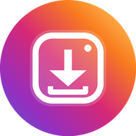
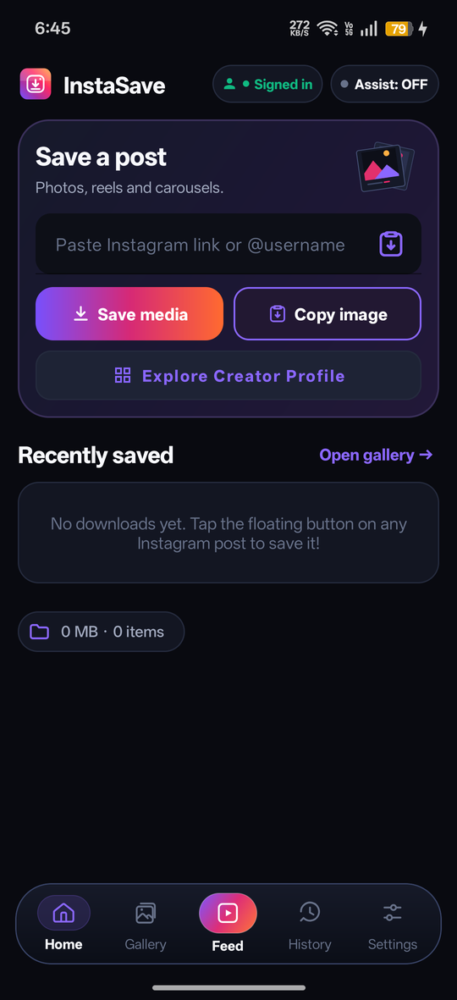
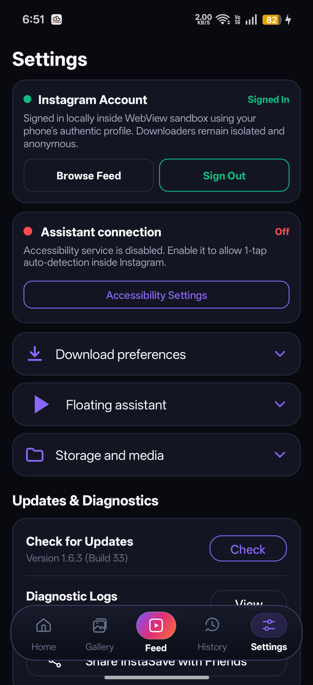
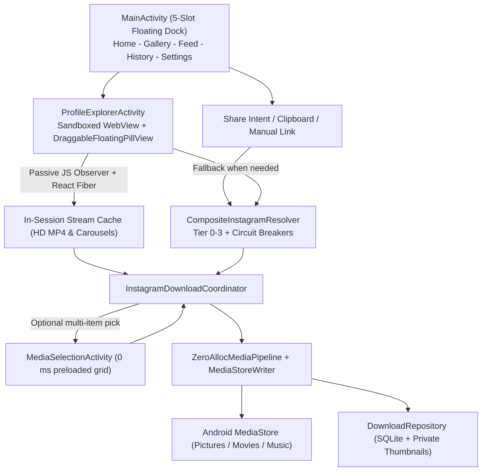

<div align="center">



# InstaSave

**Fast, private, 100% free Android utility to browse and save Instagram photos, HD Reels, and 15+ item carousels directly to your device.**

[](https://github.com/msmayanksingh22/InstaSave/releases/latest)
[-10B981?style=for-the-badge&logo=android&logoColor=white)](https://developer.android.com)
[](https://kotlinlang.org)
[](https://github.com/msmayanksingh22/InstaSave/actions/workflows/release.yml)
[](LICENSE)

[Download Latest APK](https://github.com/msmayanksingh22/InstaSave/releases/latest) · [All Releases](https://github.com/msmayanksingh22/InstaSave/releases) · [OTA Manifest](release-manifest.json) · [Report a Bug](https://github.com/msmayanksingh22/InstaSave/issues/new/choose)

</div>

---

## Interface Preview

Verified on retail Android hardware (`360dp` compact width, dark Material 3 Obsidian theme):

<table>
  <tr>
    <td align="center" width="50%">
      <br />
      <sub><b>Home &amp; 5-Slot Navigation Dock</b><br />Quick save, clipboard paste, creator lookup, and 1-tap Feed launcher</sub>
    </td>
    <td align="center" width="50%">
      <br />
      <sub><b>Settings, Storage &amp; Signed OTA Updates</b><br />Local sandbox session controls, diagnostics, and in-app updater</sub>
    </td>
  </tr>
</table>

---

## What's New in `v1.6.3` (Build 33)

- **Direct `Feed` Launcher in Lower Dock**: Redesigned the bottom navigation bar into a 5-slot Obsidian glass dock (`Home`, `Gallery`, highlighted **Feed**, `History`, `Settings`) so Instagram Feed & Reels are always one tap away.
- **Movable Floating Save Pill**: Replaced the static overlay with `DraggableFloatingPillView` — tap buttons normally or drag the capsule anywhere vertically across Feed and Reels; your preferred vertical offset persists across posts.
- **One-Tap Header Exit in Browse Feed**: Tapping the top-left back button exits Browse Feed straight back to InstaSave immediately, while Android system/gesture Back continues stepping back inside Instagram history.
- **Non-Blank History Swipe**: Upgraded History swipe gestures (`Share` right, `Options` left) to a clamped spring-back peek gesture so cancelling or closing dialogs never leaves blank gaps in the list.
- **Reliable Feed Video & Reels MP4 Extraction**: Passive in-session WebView stream observer (`PASSIVE_MEDIA_OBSERVER_JS`) and strict cover-image rescue guards ensure videos in Home Feed and the Reels tab download crisp `.mp4` streams instead of cover `.jpg` thumbnails.

---

## Core Capabilities

| Category | Highlights |
| :--- | :--- |
| **Zero-Cost & Local** | 100% free with zero subscriptions, zero paid third-party APIs, zero analytics, and zero external proxy servers. |
| **In-App Feed & Profile Explorer** | Browse creators, Home Feed, and Reels inside a sandboxed WebView (`CookieManager` stays strictly on-device — never extracted or uploaded) with automatic post/reel focus detection. |
| **4-Tier Composite Resolver** | Pre-warmed socket & GraphQL probing, passive WebView stream observer, captioned embed fallback, and headless Vue/DOM expansion protected by fast-fail `TierCircuitBreaker` cooldowns. |
| **Full 15+ Carousel Selection** | Pre-resolved items pass straight into `MediaSelectionActivity` with 0 ms grid launch and selective parallel downloads (`3–4x` concurrent streams). |
| **Zero-Copy MediaStore Pipeline** | Off-heap direct NIO buffer streaming writes directly into `MediaStore` (`Pictures/InstaSave/` or user-selected folder) with atomic rollback on failure. |
| **Persistent Offline Archive** | Stores lightweight cover thumbnails (`filesDir/thumbnails/<shortcode>.jpg`) privately so History keeps rich previews and offers 1-tap differential restore if device files are deleted. |
| **Lossless Reel Audio** | Built-in `ReelAudioExtractor` demuxes native AAC audio from saved MP4 Reels into `MediaStore.Audio.Media` (`.m4a`) with zero transcoding loss. |
| **Hardened In-App OTA Updates** | `DualSourceUpdateResolver` + `HardenedApkInstaller` verify APK signing certificates and SHA-256 digests before launching Android's PackageInstaller. |
| **ADB-Free Diagnostics** | Rolling 1,000-entry circular ring buffer (`AppLogger`) viewable inside Settings with one-tap copy and log file sharing. |

---

## Architecture Overview



---

## Installation

### Option 1: Direct APK Install (Recommended)
1. Download `InstaSave-v1.6.3.apk` from the [**Latest Release**](https://github.com/msmayanksingh22/InstaSave/releases/latest).
2. Open the APK on your Android device (Android 8.0 / API 26 or newer) and allow installation.
3. Future releases update automatically inside the app via **Settings -> Check for Updates**.

### Option 2: Install via ADB
```bash
adb install -r InstaSave-v1.6.3.apk
```

---

## Building from Source

### Prerequisites
- **JDK 17** (Temurin / OpenJDK 17)
- **Android SDK** with `compileSdk = 36` and Android 8.0+ (`minSdk = 26`)
- **Gradle Wrapper** (included: Gradle `8.14.3` / AGP `8.7.x`)

### Build & Test Commands
```bash
# Run full unit test suite (all 14 JUnit test suites)
./gradlew testReleaseUnitTest

# Run Android lint checks on release variant
./gradlew lintVitalRelease

# Assemble debug APK
./gradlew assembleDebug

# Assemble signed release APK (output: app/build/outputs/apk/release/app-release.apk)
./gradlew assembleRelease
```

---

## Permissions & Privacy

| Permission | Why It Is Requested |
| :--- | :--- |
| `INTERNET` / `ACCESS_NETWORK_STATE` | Resolving Instagram media streams and checking GitHub release manifests. |
| `POST_NOTIFICATIONS` | Displaying real-time background download progress and completion status. |
| `SYSTEM_ALERT_WINDOW` / `FOREGROUND_SERVICE_SPECIAL_USE` | Optional floating download assistant over Instagram when toggled on by the user. |
| `BIND_ACCESSIBILITY_SERVICE` | Optional accessibility helper (`InstaAccessibilityService`) used only if you enable 1-tap automated link copy inside Instagram. |
| `REQUEST_INSTALL_PACKAGES` | Enabling 1-tap self-updates directly inside **Settings -> Check for Updates**. |
| `WRITE_EXTERNAL_STORAGE` (`maxSdkVersion="28"`) | Legacy storage compatibility on Android 8–9; Android 10–16 uses Scoped `MediaStore` and `MediaStore.createDeleteRequest`. |

> **Privacy Guarantee:** Instagram sign-in inside Browse Feed uses Android's built-in `WebView` `CookieManager` sandbox locally on your device. Session cookies are never exported, logged, or transmitted to any external server.

---

## Project Structure

```text
InstaSave/
├── .github/
│   ├── ISSUE_TEMPLATE/        # Bug report & feature request YAML forms
│   ├── PULL_REQUEST_TEMPLATE.md
│   └── workflows/
│       ├── ci.yml             # Automated PR unit-test & lint checks
│       └── release.yml        # Signed APK release + manifest automation
├── app/
│   └── src/
│       ├── main/java/com/instadown/assist/
│       │   ├── browser/       # Sandboxed SPA client, route parser & passive media observer
│       │   ├── data/          # SQLite repository, MediaStore reconciliation & storage tools
│       │   ├── download/      # Parallel zero-alloc downloader & lossless .m4a extractor
│       │   ├── engine/        # Accessibility state machine & dynamic locator
│       │   ├── overlay/       # Dynamic Island HUD, spring dock & preferences
│       │   ├── resolver/      # 4-tier composite resolver & circuit breakers
│       │   └── ui/            # MainActivity, fragments, draggable pill & viewers
│       └── test/              # JUnit unit tests (resolvers, concurrency, updates, parser)
├── docs/
│   ├── images/                # App icon and verified phone screenshots
│   ├── ARCHITECTURE.md        # Subsystem architecture blueprint
│   ├── SPECIFICATIONS.md      # Technical specs & state machines
│   └── VERIFICATION_AND_TESTING.md
├── release-manifest.json      # Live OTA manifest read by AppUpdateManager
├── CONTRIBUTING.md
├── SECURITY.md
└── LICENSE
```

---

## Documentation & Community

- [Architecture Blueprint](docs/ARCHITECTURE.md)
- [Technical Specifications](docs/SPECIFICATIONS.md)
- [Verification & Physical Testing Guide](docs/VERIFICATION_AND_TESTING.md)
- [Contributing Guidelines](CONTRIBUTING.md)
- [Security & Privacy Policy](SECURITY.md)
- [AI Agent Dossier](AGENTS.md)
- Licensed under the [MIT License](LICENSE).
