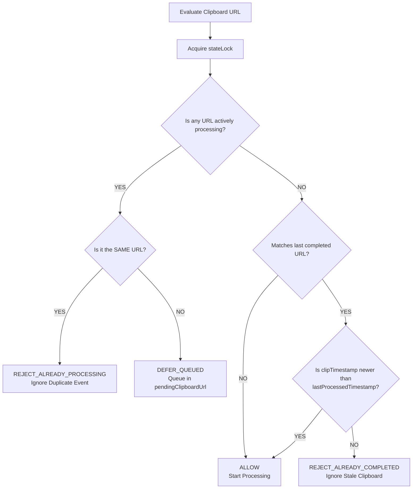
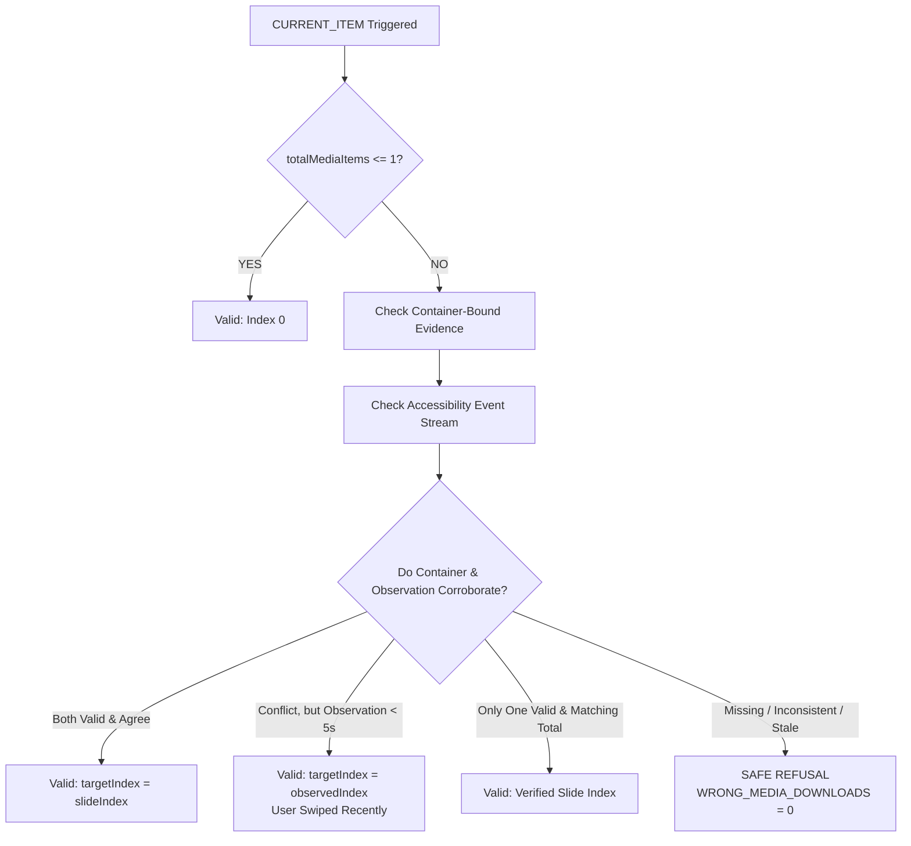

# InstaSave Architecture Blueprint

---

## 1. Architectural Philosophy & Core Invariants

InstaSave is architected around a strict unidirectional separation between the **Automation & Media Extraction Pipeline** and the **Utility & State Persistence Subsystem**. 

### 1.1 Non-Negotiable Safety Invariants
Every component, state machine, and background routine is governed by three strict invariants:

| Safety Invariant | Invariant Value | Operational Definition |
| :--- | :---: | :--- |
| `INCORRECT_CONTROL_CLICKS` | **0** | Zero misclicks on unintended controls or adjacent posts during automation. |
| `WRONG_POST_SELECTIONS` | **0** | Strict container boundary verification ensures only the target post is parsed. |
| `WRONG_MEDIA_DOWNLOADS` | **0** | Slide corroboration and strict **Safe Refusal** prevent downloading wrong carousel slides. |

### 1.2 Mandatory Architectural Boundaries
1. **Core Pipeline Decoupling**:
   - The extraction packages (`com.instadown.assist.engine`, `com.instadown.assist.resolver`, `com.instadown.assist.download`) must **NEVER** import SQLite classes, `SQLiteOpenHelper`, database DAOs, or Android UI activities.
   - The pipeline communicates its results outwards strictly via the decoupled `DownloadTransactionEvent` interface.
2. **MediaStore as the Physical Authority of Truth**:
   - The SQLite database represents the application's *logical transaction history*.
   - Android's system `MediaStore` is the *physical authority* for whether a downloaded file actually exists.
   - If a user deletes an image via Google Photos or a file manager, InstaSave detects the missing URI during background reconciliation, transitions the record to `EXTERNAL_DELETED`, and preserves history integrity without crashing.
3. **Strictly Non-Permanent CDN URLs**:
   - Signed Instagram CDN URLs expire within hours or days. The persistence layer never stores remote CDN URLs permanently; it stores only canonical metadata (`shortcode`, `postType`, `sourceUrl`, MediaStore content URIs).
4. **Conceptual Separation of Download Modes**:
   - `AUTOMATIC` (overlay trigger button) and `CLIPBOARD` (focus-based auto-download upon returning to InstaSave with overlay hidden) are persistent download modes.
   - Manual input (`+ Paste Instagram Link`) is an explicit home screen action, not a persistent mode, feeding the identical resolution and download pipeline.
5. **Stopped State Mode Isolation**:
   - Switching between `AUTOMATIC` and `CLIPBOARD` modes in `MainActivity` while the service is stopped must never boot or start `FloatingTriggerService`.
   - The toggle modifies persistent user preferences and UI state only; it explicitly checks `FloatingTriggerService.isRunning` before dispatching any service commands.
6. **Task Dismissal & Recents Swipe Resilience**:
   - Swiping `MainActivity` away from Android Recents / App Overview must not kill an active `FloatingTriggerService`.
   - `FloatingTriggerService` declares `android:stopWithTask="false"` in the Manifest and persists `isServiceRunningDesired = true` to guarantee uncompromised overlay availability on aggressive OEM task managers such as ColorOS V16.0.0.
7. **Platform Clipboard Security Compliance**:
   - On Android 10+ and strictly enforced on ColorOS V16.0.0 (API 36), passive background clipboard listening via `OnPrimaryClipChangedListener` is silenced by the OS without active window focus.
   - InstaSave uses the privacy-safe, compliant focus-based architecture: active window focus on resume or explicit user overlay trigger is required to read the clipboard.

---

## 2. High-Level Component Diagram

```
┌──────────────────────────────────────────────────────────────────────────────────────────────────┐
│                                       USER INTERACTION LAYER                                     │
│                                                                                                  │
│   ┌──────────────────────────────┐                         ┌─────────────────────────────────┐   │
│   │ FloatingTriggerService       │                         │ MainActivity (Control Center)   │   │
│   │ • Stationary Circular Overlay│                         │ • Download Mode: AUTO/CLIPBOARD │   │
│   │ • specialUse Foreground FGS  │                         │ • Carousel: ENTIRE/CURRENT/ASK  │   │
│   │ • 0px Anchor Drift Geometry  │                         │ • Unified Save Location Picker  │   │
│   │ • Edge Docking Persistence   │                         │ • + Paste Instagram Link Action │   │
│   └──────────────┬───────────────┘                         └────────────────┬────────────────┘   │
└──────────────────┼──────────────────────────────────────────────────────────┼────────────────────┘
                   │ Triggers Automation Gesture                              │ User Action / Focus Flow
                   ▼                                                          ▼
┌──────────────────────────────────────────────────────────────────────────────────────────────────┐
│                                    DOWNLOAD RESOLUTION PIPELINE                                  │
│                                                                                                  │
│   ┌──────────────────────────────────────────┐             ┌─────────────────────────────────┐   │
│   │ AutomationEngine (Accessibility)         │             │ ClipboardDownloadCoordinator    │   │
│   │ • Post Boundary Detection                │             │ • Single-Flight Concurrency Lock│   │
│   │ • Share / Overflow Button Locator        │             │ • Reentrancy & Queuing Engine   │   │
│   │ • "Copy link" Click Automation           │             │ • Multi-Signal Slide Evaluator  │   │
│   └────────────────────┬─────────────────────┘             └────────────────┬────────────────┘   │
│                        │ Acquired Clean URL                                 │ Validated Intent   │
│                        └─────────────────────────┬──────────────────────────┘                    │
│                                                  ▼                                               │
│                               ┌─────────────────────────────────────┐                            │
│                               │ InstagramResolver (Headless Engine) │                            │
│                               │ • Client-Side HTML / JSON Extraction│                            │
│                               │ • Shortcode & Post Type Parser      │                            │
│                               └──────────────────┬──────────────────┘                            │
│                                                  ▼                                               │
│                               ┌─────────────────────────────────────┐                            │
│                               │ MediaSelectionActivity (if ASK mode)│                            │
│                               │ • Visual Thumbnail Grid             │                            │
│                               │ • Selective Slide Filter            │                            │
│                               └──────────────────┬──────────────────┘                            │
│                                                  ▼                                               │
│                               ┌─────────────────────────────────────┐                            │
│                               │ InstagramDownloadCoordinator        │                            │
│                               │ • HTTP Chunked Streaming            │                            │
│                               │ • MediaStore Scoped Storage Writer  │                            │
│                               └──────────────────┬──────────────────┘                            │
└──────────────────────────────────────────────────┼───────────────────────────────────────────────┘
                                                   │ Dispatches Terminal Event
                                                   ▼
┌──────────────────────────────────────────────────────────────────────────────────────────────────┐
│                                   STORAGE & PERSISTENCE SUBSYSTEM                                │
│                                                                                                  │
│   ┌──────────────────────────────┐                         ┌─────────────────────────────────┐   │
│   │ InstaSaveDatabaseHelper      │                         │ DownloadRepository              │   │
│   │ • downloads (Transactions)   │ ◄────────────────────── │ • MediaStore Live Reconciliation│   │
│   │ • download_items (Media Rows)│                         │ • Two-Tier Storage Deletion     │   │
│   └──────────────────────────────┘                         └────────────────┬────────────────┘   │
│                                                                             │ Direct Queries     │
│                                                            ┌────────────────▼────────────────┐   │
│                                                            │ StorageAccountant               │   │
│                                                            │ • Scans Pictures/ & Movies/     │   │
│                                                            │ • Real-time Disk Usage Auditor  │   │
│                                                            └─────────────────────────────────┘   │
└──────────────────────────────────────────────────────────────────────────────────────────────────┘
```

---

## 3. Concurrency & Reentrancy Architecture (`ClipboardDownloadCoordinator`)

Handling clipboard-driven workflows on mobile devices requires defensive concurrency management. The application must handle rapid app-switching, window focus changes, duplicate clipboard events, and multi-threaded resolution calls without triggering duplicate downloads or losing user intent.

### 3.1 Synchronized State Machine
`ClipboardDownloadCoordinator.kt` maintains state using an internal monitor lock (`stateLock`) and volatile pointers:

```kotlin
class ClipboardDownloadCoordinator(private val context: Context? = null) {
    private val stateLock = Any()

    @Volatile
    var currentlyProcessingClipboardUrl: String? = null
        private set

    @Volatile
    var pendingClipboardUrl: String? = null
        private set

    @Volatile
    var pendingClipboardTimestamp: Long = 0L
        private set

    val isProcessing: Boolean
        get() = currentlyProcessingClipboardUrl != null
}
```

### 3.2 Concurrency Decision Matrix (`evaluateProcessDecision`)
Whenever a clipboard URL is evaluated (e.g. on window focus or clipboard listener event), it is evaluated against the decision matrix:

```kotlin
sealed class ProcessDecision {
    object ALLOW : ProcessDecision()
    object REJECT_ALREADY_PROCESSING : ProcessDecision()
    object REJECT_ALREADY_COMPLETED : ProcessDecision()
    object DEFER_QUEUED : ProcessDecision()
}
```



### 3.3 Transaction Lifecycle Transitions
1. **`startProcessing(url)`**:
   - Sets `currentlyProcessingClipboardUrl = cleanUrl`.
   - Logcat: `ClipboardProcessing: Started for https://instagram.com/...`
2. **`onProcessingSuccess(url, timestamp, prefs)`**:
   - Clears `currentlyProcessingClipboardUrl`.
   - Records `last_processed_clip_url = cleanUrl` and `last_processed_clip_timestamp = timestamp` in `instasave_settings.xml`.
   - Logcat: `ClipboardProcessing: Success for ... (recorded timestamp=...)`
3. **`onProcessingFailed(url)`**:
   - Clears `currentlyProcessingClipboardUrl`.
   - **Crucial Invariant**: Does **NOT** record the URL as completed in `SharedPreferences`. Retrying the download immediately is fully allowed.
   - Logcat: `ClipboardProcessing: Failed for ... (URL not permanently marked as processed)`
4. **`pollPending()`**:
   - Called upon completion or failure of the active transaction. If a secondary URL was queued in `pendingClipboardUrl`, it is atomically retrieved, cleared, and initiated.

---

## 4. Carousel Resolution & Multi-Signal Corroboration Engine

### 4.1 Granular Carousel Behaviors
The user configures `CarouselDownloadBehavior` via the Control Center:
- **`ENTIRE_CAROUSEL`**: Downloads all media files in the carousel automatically in the background.
- **`CURRENT_ITEM`**: Downloads only the single slide visible when the action was triggered.
- **`ASK`**: Context-aware slide selection depending on trigger environment:
  - **In-App / Clipboard Trigger**: Immediately launches `MediaSelectionActivity` with visual thumbnail cards.
  - **Overlay / Automatic Trigger**: Avoids disrupting the foreground app with an intrusive full-screen activity. Instead, InstaSave issues a high-priority Heads-Up Prompt Notification (`showCarouselPromptNotification`) on the dedicated `instasave_prompts_channel` (`IMPORTANCE_HIGH`, `CATEGORY_EVENT`).
    The notification presents three direct actions:
    1. **`SAVE ALL`**: Dispatches an explicit broadcast to `CarouselActionReceiver` (`ACTION_CAROUSEL_SAVE_ALL`) to download all items immediately in the background.
    2. **`CHOOSE`**: Direct intent launching `MediaSelectionActivity` with `EXTRA_URL` for full visual thumbnail filtering.
    3. **`CURRENT`**: Dispatches broadcast to `CarouselActionReceiver` (`ACTION_CAROUSEL_SAVE_CURRENT`) to save strictly the visible slide.
  - **Floating Overlay Visual Invariant**: Upon issuing the prompt notification, the floating overlay button immediately transitions cleanly back to `VisualState.IDLE`. It never displays a false green checkmark (`VisualState.SUCCESS` is reserved exclusively for completed file downloads), preventing false user confidence.

### 4.2 Multi-Signal Slide Indicator Corroboration
For `CarouselBehavior.CURRENT_ITEM`, a simple string match is insufficient to prevent downloading the wrong slide. InstaSave requires corroboration across multiple independent signals:

```kotlin
fun resolveCurrentSlideIndex(
    autoResult: AutomationResult?,
    totalMediaItems: Int,
    observedSlide: InstaAccessibilityService.ObservedSlideInfo?,
    currentTimeMs: Long = System.currentTimeMillis()
): SlideEvaluationResult
```

#### Evaluation Rules:
1. **Single Item Check**: If `totalMediaItems <= 1`, the post is not a carousel; index `0` is always valid.
2. **Post Container Walking**:
   - `InstaAccessibilityService` walks up the accessibility node hierarchy from the touch/focused node to find the enclosing post container (`width > 600px` and `height > 400px`).
   - Only indicators found within this target container are accepted, preventing contamination from adjacent feed posts.
3. **Slide Indicator Pattern Matching**:
   - Searches node `text` and `contentDescription` for patterns matching:
     $$\text{Pattern} = \text{"(\textbackslash d\{1,2\})\textbackslash s*(?:of|/)\textbackslash s*(\textbackslash d\{1,2\})"}$$
   - Parses `currentSlide` and `totalSlides`.
4. **Total Count Corroboration**:
   - The indicator's `totalSlides` must strictly equal the headless resolver's `totalMediaItems`. If the indicator says "2 of 4" but the post resolves to 6 items, the indicator is declared invalid.
5. **Freshness Window Check**:
   - Observed slides must have a timestamp age within `MAX_SLIDE_OBSERVATION_AGE_MS = 30000L` (30 seconds).



### 4.3 Safe Refusal Contract
When slide evidence is missing, inconsistent, or stale:
- InstaSave **NEVER** guesses and **NEVER** silently downloads the entire carousel.
- Exactly **0 items are downloaded**.
- The transaction terminates with `errorCode = DownloadErrorCode.TARGET_SELECTION_FAILED`.
- The user receives clear, actionable feedback on screen:
  `"Safe Refusal: Couldn't identify current slide (0 saved)"`.
- The `WRONG_MEDIA_DOWNLOADS = 0` invariant is mathematically preserved.

---

## 5. Interactive Media Selection Architecture (`MediaSelectionActivity`)

When `CarouselDownloadBehavior.ASK` is active:
1. `InstagramResolver` resolves the post and identifies multiple items (`totalItems > 1`).
2. **Context Routing**:
   - **From In-App Clipboard / Manual Paste**: `MediaSelectionActivity` is launched directly with `EXTRA_URL` (`"extra_instagram_url"`).
   - **From Floating Overlay**: The user receives a heads-up prompt notification and taps `CHOOSE`, which launches `MediaSelectionActivity` with `EXTRA_URL`.
3. `MediaSelectionActivity` displays:
   - High-resolution thumbnail cards with slide index badges (`#1`, `#2`, ...).
   - Dynamic counter: `"X of Y items selected"`.
   - Quick bulk action: `SELECT ALL` toggles to `CLEAR ALL`.
   - Download CTA: `DOWNLOAD SELECTED (N)`.
4. User selections generate an array of 0-based indices (`selectedIndices: IntArray`).
5. `MediaSelectionActivity` passes `selectedIndices` into `InstagramDownloadCoordinator.executeDirectDownload()`:
   - `DownloadPlanner` filters the resolved items to include strictly the requested indices.
   - Non-selected items are completely skipped.

---

## 6. The Transaction Event Bus

Decoupling between the extraction pipeline and persistence is achieved through `DownloadTransactionEvent`:

```kotlin
data class DownloadTransactionEvent(
    val transactionId: String,
    val status: TransactionStatus,
    val shortcode: String,
    val postType: PostType,
    val sourceUrl: String,
    val carouselCount: Int,
    val completedCount: Int,
    val failedCount: Int,
    val totalBytes: Long,
    val timestamp: Long,
    val items: List<DownloadItemResult>,
    val errorMessage: String? = null
)

data class DownloadItemResult(
    val itemIndex: Int,
    val mediaType: MediaType,
    val mediaUri: Uri?,          // NULL if failed, queued, or skipped duplicate
    val fileName: String,
    val width: Int,
    val height: Int,
    val sizeBytes: Long,
    val status: ItemStatus
)
```

### Lifecycle Dispatch Guarantee
- The event is dispatched **on every terminal state**: `SUCCESS`, `PARTIAL_SUCCESS`, `FAILED`, `CANCELLED`, or `DUPLICATE`.
- For partial failures (e.g. 4 of 5 carousel slides succeed, 1 fails), the transaction status is marked `PARTIAL_SUCCESS`, successful items are marked `AVAILABLE` with valid `mediaUri`s, and failed items are marked `FAILED` with `mediaUri = null`.

---

## 7. MediaStore Authority & Live Reconciliation

`DownloadRepository` performs live reconciliation between SQLite records and Android `MediaStore`:

```
SQLite Query ──► DownloadRecord (items with media_uri)
                       │
                       ▼
         Verify URI via ContentResolver
                       │
            ┌──────────┴──────────┐
            ▼                     ▼
     File Exists             File Missing
            │                     │
            ▼                     ▼
     Keep AVAILABLE      Mark EXTERNAL_DELETED
```

### 7.1 Reconciliation Logic
1. When `MainActivity` resumes, it queries all records where `status == ItemStatus.AVAILABLE`.
2. Verifies each `media_uri` with `contentResolver.query(uri, arrayOf(MediaStore.MediaColumns._ID), null, null, null)`.
3. If query returns empty cursor, null, or throws `SecurityException` / `FileNotFoundException`, the item status in SQLite is updated to `EXTERNAL_DELETED`.
4. If an unexpected `IllegalStateException` or general provider failure occurs, item is marked `VERIFY_ERROR` to avoid falsely declaring a file missing during temporary OS glitches.

### 7.2 Two-Tier Deletion Flow
- **Remove from History (Keep Files)**:
  `repository.deleteDownloadRecord(downloadId)` executes `DELETE FROM downloads WHERE id = ?`. Child items are cascaded; files on disk remain completely untouched.
- **Delete All Files (Remove from Storage)**:
  `repository.deleteDownloadAndMedia(context, downloadId)` queries all associated `media_uri`s, calls `contentResolver.delete(uri, null, null)`, and then deletes the database row.

---

## 8. Storage Accounting Architecture

`StorageAccountant.kt` bypasses the database completely to determine disk usage, establishing `MediaStore` as the sole authority:

```kotlin
// MediaStore Query Scopes:
val photoCollection = MediaStore.Images.Media.EXTERNAL_CONTENT_URI
val videoCollection = MediaStore.Video.Media.EXTERNAL_CONTENT_URI

// Target Directories:
// - Pictures/InstaSave/ (or user-selected folder)
// - Movies/InstaSave/
```

- Executed asynchronously on `Dispatchers.IO`.
- Queries `MediaStore.MediaColumns.SIZE` directly for all files in the relative path.
- Invalidation triggers execute on download completion and deletion events.
- Accurately reflects true physical disk usage regardless of whether files were added via InstaSave or deleted via external gallery apps.

---

## 9. Threading & Concurrency Model

InstaSave utilizes Kotlin Coroutines and structured concurrency across all operational boundaries:

| Layer / Component | Execution Context | Dispatcher / Threading |
| :--- | :--- | :--- |
| **Accessibility Automation** | Main looper / Accessibility event thread | Fast, non-blocking node traversal (<150ms) |
| **Clipboard Concurrency Coordinator** | Synchronized State Machine | Thread-safe monitor locks (`stateLock`) |
| **Headless Resolver** | Coroutine Scope | `Dispatchers.IO` (Network & HTML parsing) |
| **Media Downloader** | Coroutine Scope | `Dispatchers.IO` (Chunked HTTP streaming) |
| **MediaStore Writes** | Coroutine Scope | `Dispatchers.IO` (Scoped Storage file output) |
| **Database Transactions** | Coroutine Scope | `Dispatchers.IO` (SQLite queries and updates) |
| **Storage Accounting** | Background Job | `Dispatchers.IO` (Cursor scanning) |
| **Floating Overlay UI** | Android Main Looper | `Dispatchers.Main` (WindowManager layout updates) |
| **Dashboard & Selection UI** | Activity Lifecycle Scope | `Dispatchers.Main` (View binding & state observation) |
